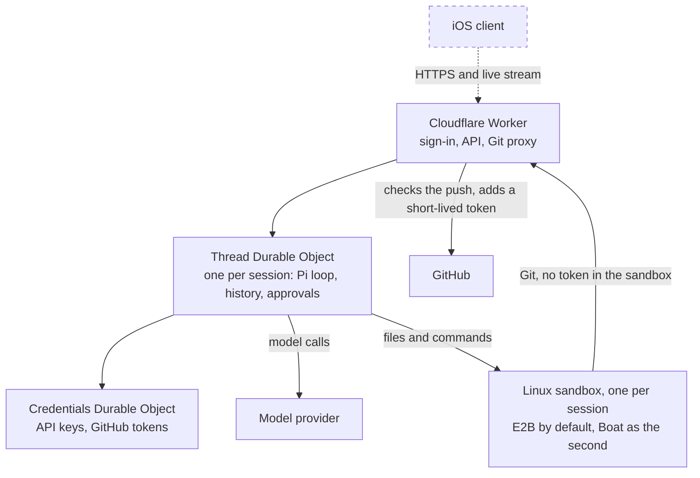
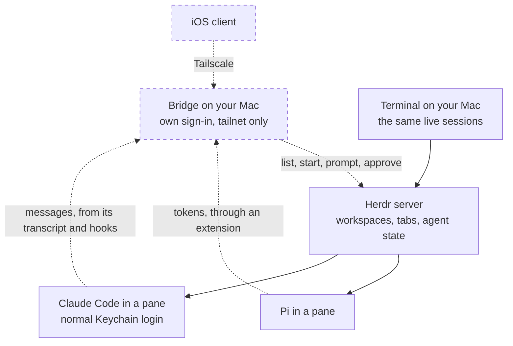

# cloud-swe

A personal coding agent you can run from anywhere. Cloud sessions run [Pi](https://github.com/earendil-works/pi) in a durable Cloudflare backend, with one Linux sandbox per session. Local sessions run Pi and Claude Code on your Mac, and you'll follow and control them from a clean iOS app instead of a terminal.

**Status:** the cloud backend works end to end, tested live on a real clone, edit, push and draft PR. There's no client app yet. The local side is designed but not built.

## Architecture

Solid lines exist today. Dashed lines and dashed boxes are planned.

### Cloud

### Local

Each session is one process, and every client is a view of it. No Claude credential ever enters the cloud.

## Todos

### Cloud

**Core**

- [x] GitHub sign-in for one allowed account
- [x] A sandbox for each session, with safe retries when a create request is lost
- [x] Client-managed Anthropic API key, kept out of the sandbox
- [x] Durable messages, steering, follow-ups and cancellation
- [x] Conversation snapshots, history and live streaming, including tool activity
- [x] Every client on a session stays in sync
- [x] Read, write, edit and shell tools, including parallel calls and codemode
- [x] Safe recovery of commands after a restart, with no blind re-runs
- [x] Automatic compaction
- [x] Web search and page fetching
- [x] Keep-alive during a run, auto-stop after it and resume on the next message

**Git**

- [x] Clone, including private repos
- [x] Git proxy limited to one session branch, with approvals for anything riskier
- [x] Pull request tools
- [x] Git proxy retry on GitHub 429s (tested against a fake GitHub; not yet measured on real GitHub)

**Infrastructure**

- [x] E2B adapter as the default provider, with Boat as the second (proven on E2B through the deployed Worker, including Git through the proxy)
- [ ] Environments with normal secrets and network secrets
- [ ] Worker proxy for network secrets
- [ ] One port URL per repo and port, through a Worker proxy

**Features**

- [x] `ask_user_question` tool
- [x] Todos tool
- [ ] Conversation tree and reversal, with optional code reversal
- [ ] Image attachments
- [ ] Background shells
- [ ] Client terminal
- [ ] `agent-browser` automation and computer use
- [ ] ChatGPT sign-in for Pi
- [ ] Attach, fork, subagents and an orchestrator
- [ ] Sandbox size selection and automatic cleanup

### Local

**Bridge**

- [x] Test attach and phone-started sessions on an isolated Herdr session, with a fake model API ([evidence](experiments/herdr-attach/README.md))
- [ ] Repeat with a real Claude login and a real model
- [ ] Bridge service with its own sign-in, private to the tailnet
- [ ] Only allowed directories can be opened or started in
- [ ] Reports the Mac as unreachable instead of showing a session as idle

**Sessions**

- [ ] List workspaces and running Pi and Claude agents
- [ ] Start a Pi or Claude agent in a chosen directory, workspace or new tab
- [ ] Pi on the phone, token by token, through an extension
- [ ] Claude Code on the phone, a message at a time from its transcript, with an optional live preview
- [ ] Send messages from the phone without merging into text half-typed on the Mac
- [ ] Approvals and first-run prompts as real buttons, reading the screen before pressing keys
- [ ] Push alerts when an agent needs you

### iOS app

- [ ] Cloud and local sessions in one list
- [ ] Directory and workspace browser
- [ ] Conversation view with tool cards and approvals

## Docs

| Doc                                                              | Holds                                                |
| ---------------------------------------------------------------- | ---------------------------------------------------- |
| [`docs/architecture.md`](docs/architecture.md)                   | Design, security boundaries and dated decisions      |
| [`docs/mvp.md`](docs/mvp.md)                                     | Detailed scope and status                            |
| [`docs/infra-decisions.md`](docs/infra-decisions.md)             | Credentials, secrets, providers and the test results |
| [`docs/effect.md`](docs/effect.md)                               | Where Effect is used                                 |
| [`experiments/herdr-attach`](experiments/herdr-attach/README.md) | Evidence for attaching to Herdr sessions             |
| [`AGENTS.md`](AGENTS.md)                                         | Rules for working in this repo                       |
