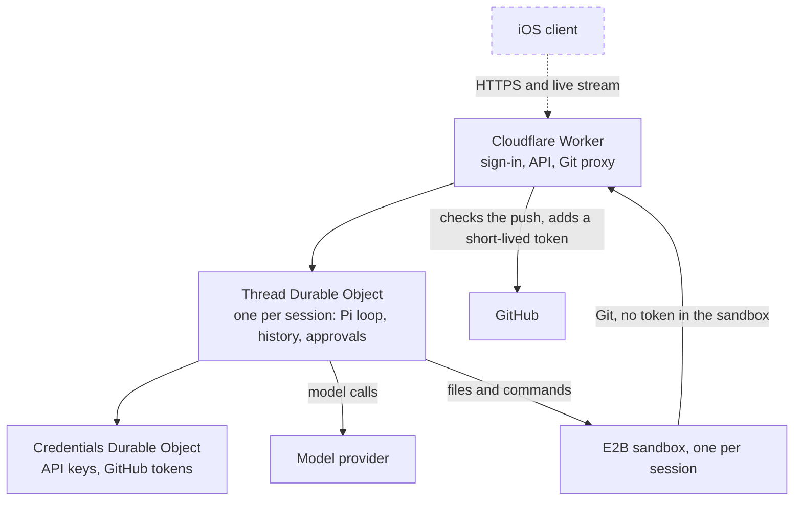

# cloud-swe

A personal coding agent you can run from anywhere. Sessions run [Pi](https://github.com/earendil-works/pi) in a durable Cloudflare backend, with one E2B sandbox per session, and you'll follow and control them from a clean iOS app instead of a terminal.

**Status:** the cloud backend works end to end, tested live on a real clone, edit, push and draft PR. There's no client app yet.

## Architecture

Solid lines exist today. Dashed lines and dashed boxes are planned.

## Todos

**Core**

- [x] GitHub sign-in for one allowed account
- [x] A sandbox for each session, with safe retries when a create request is lost
- [x] Client-managed Anthropic API key, kept out of the sandbox
- [x] Durable messages, steering, follow-ups and cancellation
- [x] Conversation snapshots, history and live streaming, including tool activity
- [x] Every client on a session stays in sync
- [x] Read, write, edit and shell tools, including parallel calls and codemode
- [x] Safe recovery of commands after a restart, with no blind re-runs
- [x] Automatic compaction
- [x] Web search and page fetching
- [x] Keep-alive during a run, auto-stop after it and resume on the next message

**Git**

- [x] Clone, including private repos
- [x] Git proxy limited to one session branch, with approvals for anything riskier
- [x] Pull request tools
- [x] Git proxy retry on GitHub 429s (tested against a fake GitHub; not yet measured on real GitHub)

**Infrastructure**

- [x] E2B as the sandbox provider (proven through the deployed Worker, including Git through the proxy)
- [x] Environments with normal secrets and network secrets
- [x] Worker proxy for network secrets
- [ ] One port URL per repo and port, through a Worker proxy

**Features**

- [x] `ask_user_question` tool
- [x] Todos tool
- [ ] Conversation tree and reversal, with optional code reversal
- [ ] Image attachments
- [ ] Background shells
- [ ] Client terminal
- [ ] `agent-browser` automation and computer use
- [ ] ChatGPT sign-in for Pi
- [ ] Attach, fork, subagents and an orchestrator
- [ ] Sandbox size selection and automatic cleanup

**iOS app**

- [ ] Session list
- [ ] Conversation view with tool cards and approvals

## Docs

| Doc                                                    | Holds                                                |
| ------------------------------------------------------ | ---------------------------------------------------- |
| [`docs/architecture.md`](docs/architecture.md)         | Design, security boundaries and dated decisions      |
| [`docs/mvp.md`](docs/mvp.md)                           | Detailed scope and status                            |
| [`docs/infra-decisions.md`](docs/infra-decisions.md)   | Credentials, secrets, providers and the test results |
| [`docs/effect.md`](docs/effect.md)                     | Where Effect is used                                 |
| [`experiments/e2b-e2e`](experiments/e2b-e2e/README.md) | The whole product on E2B through the deployed Worker |
| [`AGENTS.md`](AGENTS.md)                               | Rules for working in this repo                       |
