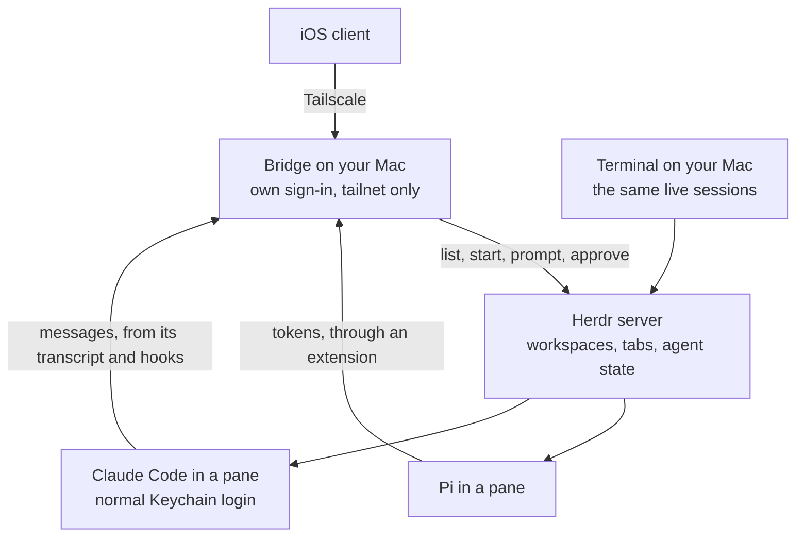

# Local sessions: research

Standalone research on running Pi and Claude Code on your Mac and controlling them from a phone. It isn't planned, scheduled or in scope; nothing here is a decision for the app. It collects what was investigated and tested between 2026-10-29 and 2026-11-01 so it doesn't have to be rediscovered.

The app is built for the cloud only. Local agents are already well served by existing tools such as Rex, Herdr and T3 Code, so the app isn't designed around them. Revisit this only if something becomes possible that's substantially better than what those tools provide.

## The idea

Pi and Claude Code run on your Mac, inside Herdr panes, with Claude Code's normal login in the macOS Keychain. A small bridge on the Mac, private to the tailnet and with its own sign-in, uses Herdr's socket API to list workspaces and running agents, start new ones in a chosen directory, send prompts and answer approvals. An iOS client talks only to the bridge over Tailscale.

Each session is one process in one pane, and every client is a view of it, so nothing has to resume or hand over. A phone message is typed into that terminal, so the Mac shows it live. Pi would reach the phone token by token through an extension; Claude Code a message at a time from its transcript, with live state from Herdr and a preview read from the screen.

`hc` (herdr-core) has no workspaces or tabs, and Rex has no control API that could be found, so both were revisit items, not dependencies.

## Why Claude Code would run here

Anthropic's [legal page](https://code.claude.com/docs/en/legal-and-compliance) says developers "may not collect, store, or intermediate Claude.ai credentials or session tokens", and that sign-in "must complete through Anthropic's own flow". It allows "an end user signing in to the unmodified Claude Code binary with their own Claude subscription, including where a platform hosts Claude Code". Running the official binary on your own Mac with its own login is the cleanest reading of that: the app never holds a Claude credential.

- The [plan help article, updated October 7, 2026](https://support.claude.com/en/articles/15036540-use-the-claude-agent-sdk-with-your-claude-plan) says signed-in Agent SDK and `claude -p` usage draw from subscription limits; an API key from a linked Console organization uses API billing instead.
- The [SDK overview](https://code.claude.com/docs/en/agent-sdk/overview) says third-party developers may not offer Claude.ai login or rate limits for their products without prior approval.
- Don't transplant subscription OAuth into Pi, spoof Claude Code headers, pool accounts or add an app-owned Claude login. Make sure an inherited API-key variable can't silently select the wrong billing path.
- Keep the existing encrypted Keychain login; never extract or upload the Mac's credentials.

## Evidence: driving Herdr sessions

Tested 2026-11-01 with real Claude Code 2.1.316, Pi 1.4.0 and Herdr 0.9.5 in an isolated Herdr session, driven only through Herdr's CLI, with dummy credentials and a fake model API. No real login, bridge or phone. Runnable evidence: [`experiments/herdr-attach`](../experiments/herdr-attach/README.md), 34 of 35 checks passed.

Found, and would need handling:

- A phone message merges with text half-typed on the Mac, on both agents (the failed check).
- `agent_prompt_stalled` was seen when a reply finished instantly and the message had been delivered, so never retry on it.
- A first run in a new folder stops on a trust prompt whose default is "No, exit".
- Claude Code's transcript format and dialogs are internal and could change.

## Herdr, from source

Read at [`herdrdev/herdr-core@298d9c9`](https://github.com/herdrdev/herdr-core/tree/298d9c9094ce36c2c80c8bd917032458d5f440f1) (Herdr Core 0.1.14) on 2026-10-29. Nothing was run at that point.

- [`holder.rs`](https://github.com/herdrdev/herdr-core/blob/298d9c9094ce36c2c80c8bd917032458d5f440f1/crates/herdr-core/src/holder.rs): holder processes own PTYs and child processes independently of the core, so core restarts and viewer disconnects needn't kill the program.
- [`api/run.rs`](https://github.com/herdrdev/herdr-core/blob/298d9c9094ce36c2c80c8bd917032458d5f440f1/crates/herdr-core/src/api/run.rs): launch resolves a template or shell command, assigns parent ownership, persists a terminal claim and asks the holder to spawn, injecting terminal identity into the environment.
- [`input.rs`](https://github.com/herdrdev/herdr-core/blob/298d9c9094ce36c2c80c8bd917032458d5f440f1/crates/herdr-core/src/input.rs): `send` uses a per-terminal queue, waits for human typing to pause, bracket-pastes where supported, then sends the submission key. It refuses normal sends to a program reported blocked unless forced. This is terminal input coordination, not a typed conversation submission.
- [`notes.rs`](https://github.com/herdrdev/herdr-core/blob/298d9c9094ce36c2c80c8bd917032458d5f440f1/crates/herdr-core/src/notes.rs): parent notifications are marked text typed into the parent's terminal. Herdr tracks child news/seen state, notifies about blocked, error and exited children, and ends children with the parent unless configured otherwise. [`remote.rs`](https://github.com/herdrdev/herdr-core/blob/298d9c9094ce36c2c80c8bd917032458d5f440f1/crates/herdr-core/src/remote.rs) adds cross-machine routing and outboxes for some peer notifications. Useful for mixed CLI collaboration, but not an exactly-once conversation transport.
- [`kept.rs`, lines 68–100](https://github.com/herdrdev/herdr-core/blob/298d9c9094ce36c2c80c8bd917032458d5f440f1/crates/herdr-core/src/kept.rs#L68-L100): recovery replaces the lost program with the machine's shell and clears template and status fields. `--keep` isn't restart-and-resume.
- [API contract](https://github.com/herdrdev/herdr-core/blob/298d9c9094ce36c2c80c8bd917032458d5f440f1/schema/README.md): local Unix socket or named pipe, JSON-RPC, optional framed PTY streams, terminal events and OSC 7501 program status. Event sequence numbers restart with the core, so subscribers must resnapshot; never reuse them as a durable SSE cursor. No universal conversation or approval schema.
- [Security contract](https://github.com/herdrdev/herdr-core/blob/298d9c9094ce36c2c80c8bd917032458d5f440f1/docs/security.md): anyone connected to the API has the core account's shell and file access. Core is not a sandbox or a permission broker, so never expose the raw socket through an unauthenticated tunnel or to sandboxed agents on the Mac.

## Adapters on the Mac

1. **Pi sessions already in Herdr:** a Pi extension is the best way to keep the live session. The [extension API](https://github.com/earendil-works/pi/blob/f09d01b85e0384647fcab6779d35ab9dabe04be3/packages/coding-agent/src/core/extensions/types.ts) exposes message and tool events, session-manager reads, and `sendUserMessage` with steer and follow-up semantics. Herdr alone doesn't expose these events. Serialize competing local and remote control.
2. **New managed Pi sessions:** [Pi RPC](https://github.com/earendil-works/pi/blob/f09d01b85e0384647fcab6779d35ab9dabe04be3/packages/coding-agent/docs/rpc.md) or the SDK gives structured state and events. `pi --mode rpc` is a startup mode, not a way to attach to an existing interactive process. A prompt acknowledgment isn't completion; wait for `agent_settled`. Request IDs correlate responses but aren't durable deduplication.
3. **Claude:** SDK-managed sessions have structured events and [permission and question callbacks](https://code.claude.com/docs/en/agent-sdk/user-input). The [Python SDK transport](https://github.com/anthropics/claude-agent-sdk-python/blob/27858cbba9ecee26a06a90b8d39d3b5596121d11/src/claude_agent_sdk/_internal/transport/subprocess_cli.py#L570) starts a `claude` subprocess with stream-json in and out, and its [control handler](https://github.com/anthropics/claude-agent-sdk-python/blob/27858cbba9ecee26a06a90b8d39d3b5596121d11/src/claude_agent_sdk/_internal/query.py#L577) answers `can_use_tool`, so this adapter needs a process-capable host. Resuming history in a new SDK process isn't attaching to the live one ([sessions](https://code.claude.com/docs/en/agent-sdk/sessions)); use explicit session IDs, never "continue the newest in this directory". Taking over an arbitrary existing Claude terminal is an open spike; the safe fallback is an explicit idle, stop-and-resume handoff with one writer.
4. **Codex:** [app-server](https://developers.openai.com/codex/app-server/) is built for rich clients: history, events, approvals and steering. The [running-thread resume path](https://github.com/openai/codex/blob/e9854c0aa52d494fa4f4c3683741461e2640011b/codex-rs/app-server/src/request_processors/thread_processor.rs#L3918) delegates to a thread already loaded in that server, which isn't evidence that another server can attach to an independent process. WebSocket transport is labelled experimental; version-pin the protocol.

Each adapter keeps its engine's conversation, permission, interruption and resume semantics. One authority runs each engine session: never let two runtimes drive the same session files or conversation.

## Tailscale

- The phone connects straight to the authenticated bridge over the tailnet. [Tailscale Serve](https://tailscale.com/kb/1312/serve) keeps it tailnet-only; [Funnel](https://tailscale.com/kb/1223/funnel) publishes to the internet and isn't needed.
- A Cloudflare Worker isn't a tailnet member because the Mac and phone are. Don't assume it can reach a MagicDNS name or 100.x address. If traffic must go through the cloud API, use an authenticated outbound Mac-to-cloud connection or a deployed tailnet gateway.
- Tailscale doesn't keep the Mac awake, restore dead processes or authorize anything. Report an asleep or unreachable Mac as such; never show it as idle or run queued input elsewhere.

## State ownership

| State                                                        | Authority                                                                    |
| ------------------------------------------------------------ | ---------------------------------------------------------------------------- |
| Claude transcript and native session identity                | Claude's own session storage on the Mac                                      |
| Claude accepted operations, pending approvals, UI projection | The bridge's receipt records, reconciled explicitly against Claude's state   |
| Files and worktrees                                          | The Mac filesystem                                                           |
| Live PTYs, processes and screens                             | Herdr's holder and core                                                      |
| A Mac agent session                                          | The Mac adapter; a cloud index may mirror metadata but never become a writer |

A session ID must map to a machine or core identity plus the engine's session identity; Herdr's `t3` alone isn't globally unique. Keep app thread IDs, engine session IDs, terminal addresses and operation IDs distinct. An app approval record doesn't keep a Claude callback alive across a runner death; stale callbacks must be invalidated.

## Questions and todos, cloud versus local

Cloud sessions run native `ask_user_question` and `todo` tools on Pi Durable. Local Pi would run the real `rpiv-ask-user-question` and `rpiv-todo` packages, surfaced through an extension and the bridge. Claude Code has neither, so it would need its own adapter. The local column comes from reading the packages, not from running a bridge.

| Area                             | Cloud (native tools)                                                             | Local Pi (real packages)                                                            | To reconcile                                                              |
| -------------------------------- | -------------------------------------------------------------------------------- | ----------------------------------------------------------------------------------- | ------------------------------------------------------------------------- |
| Waiting for an answer            | Returns at once; the agent works on, then ends its turn when it needs the answer | The tool call blocks until answered                                                 | Clients show an open question the same way; only local holds the run open |
| How the model gets the answer    | A steering user message                                                          | The tool result                                                                     | Same wording, different place in the transcript                           |
| Asking and answering             | `Session.questions` and `POST /v1/sessions/:sessionId/questions/:questionId`     | `rpiv:ask-user:prompt`, `blocked`, `answer` and `answer-result` events              | The bridge exposes the cloud's shape                                      |
| Question ID                      | UUID derived from the call ID                                                    | `toolCallId`                                                                        | The bridge derives the UUID                                               |
| Open questions after a reconnect | Stored and sent in every snapshot                                                | Events are live-only                                                                | The extension or bridge must remember open questions                      |
| Previews                         | Sent to the client in full; not repeated to the model                            | The prompt event has only `hasPreview`; the chosen preview is repeated to the model | Read the content from the tool call's arguments (unverified)              |
| A second answer                  | 200 with the first answer, so a lost response can be retried                     | Refused with `not_found`                                                            | The bridge returns the first answer                                       |
| Answer errors                    | 400 `invalid_request`                                                            | `invalid_payload`, `invalid_answer`, `not_found`, `unsupported_host`                | The bridge maps them to API errors                                        |
| A note on a decline              | Not accepted                                                                     | Kept in `details`; the model doesn't see it                                         | Drop it at the bridge                                                     |
| Calls from codemode              | `ask_user_question` is not available                                             | Not checked                                                                         | Check when a bridge exists                                                |
| Size limits                      | Our own limits on text and on 100 todo tasks (`QUESTION_LIMITS`, `TODO_LIMITS`)  | None on those fields                                                                | The bridge must handle text past our limits before it fits the schemas    |
| Todo state                       | A rewindable Pi document, read into `Session.todos`                              | `rpiv-todo-state` entries on the session branch                                     | The extension reads the newest entry; which hook to use is unverified     |
| Todo fields                      | No `owner`, `metadata` or `includeDeleted`                                       | All three                                                                           | The bridge drops them until the schema has them                           |
| Terminal text sanitizing         | None; clients render the text themselves                                         | Applied by `rpiv-todo` for its terminal panel                                       | Clients treat task text as untrusted                                      |

## Across engines and machines

- Use one small app-level delivery interface across engine and machine boundaries: start or delegate with an explicit owner and worktree policy, send with a stable delivery ID and steer or follow-up behavior, observe completion through a reporter or outbox, and cancel with explicit ownership.
- A Pi coordinator could delegate a review to Claude or a Mac session without pretending those agents use Pi's transcript. An engine that can't deduplicate accepted input can't offer exactly-once delivery.
- Don't run PiHarness to pretend Claude is a Pi model provider: Claude's SDK owns its whole agent loop. Pi to Claude is a cross-engine handoff, not `setModel`.
- Herdr's `hc send` stays useful between interactive terminal agents, but headless Pi Durable and SDK sessions need structured adapters; a JSON protocol in a PTY fed terminal text isn't equivalent. If a managed session also shows as an hc terminal, bridge or disable overlapping notes so nothing is delivered twice.
- Effect fits a Mac runner well: scoped subprocesses, concurrent stdout, stderr and events, reconnect and resource cleanup. The official engine still owns its session; runner receipts, session files and generation-bound approvals must reconcile after a restart. Don't wrap Claude in Effect AI as a second model loop.

## Gates before calling it reliable

- Restart the Claude adapter during generation, a command and an approval; check uncertainty and stale-approval handling.
- Drop Tailscale or sleep the Mac; distinguish unreachable from idle and avoid duplicate sends.
- Confirm the real Claude subscription billing and auth mode, with no silent API-key fallback.
- Repeat the Herdr evidence with a real Claude login and a real model.

## What a build would have covered

- Bridge service with its own sign-in, private to the tailnet; only allowed directories can be opened or started in.
- List workspaces and running Pi and Claude agents; start one in a chosen directory, workspace or new tab.
- Pi on the phone token by token through an extension; Claude Code a message at a time from its transcript, with an optional live preview.
- Phone messages that don't merge into text half-typed on the Mac.
- Approvals and first-run prompts as real buttons, reading the screen before pressing keys.
- Push alerts when an agent needs you, and one session list in the client.

## Sources

Checkouts resolved with the librarian skill into `~/.cache/checkouts/github.com/` on 2026-10-29: `herdrdev/herdr-core` (`298d9c9`), `anthropics/claude-agent-sdk-typescript` (`e296380`, which doesn't expose the complete agent loop), `anthropics/claude-agent-sdk-python` (`27858cb`), `openai/codex` (`e9854c0`) and `earendil-works/pi` (`f09d01b`). Claude's closed binary internals weren't audited.
